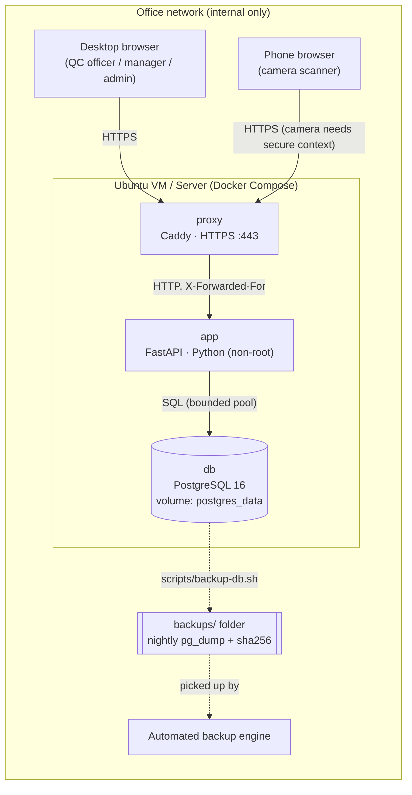
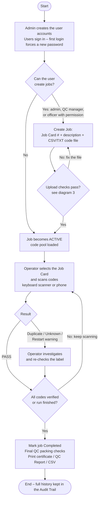
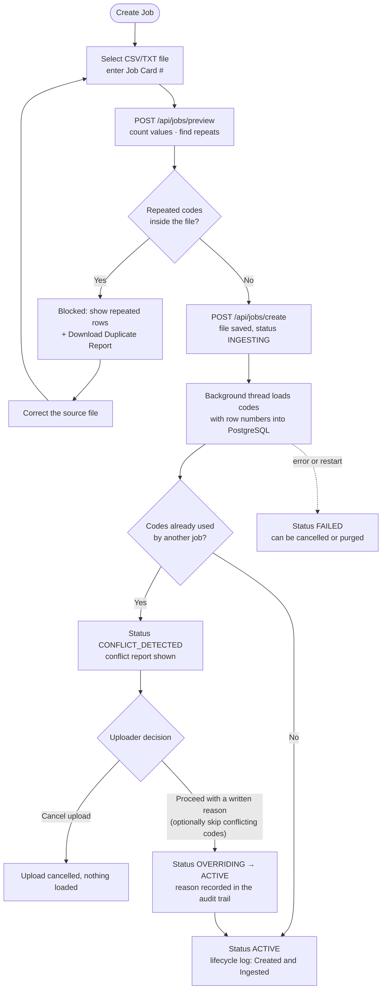
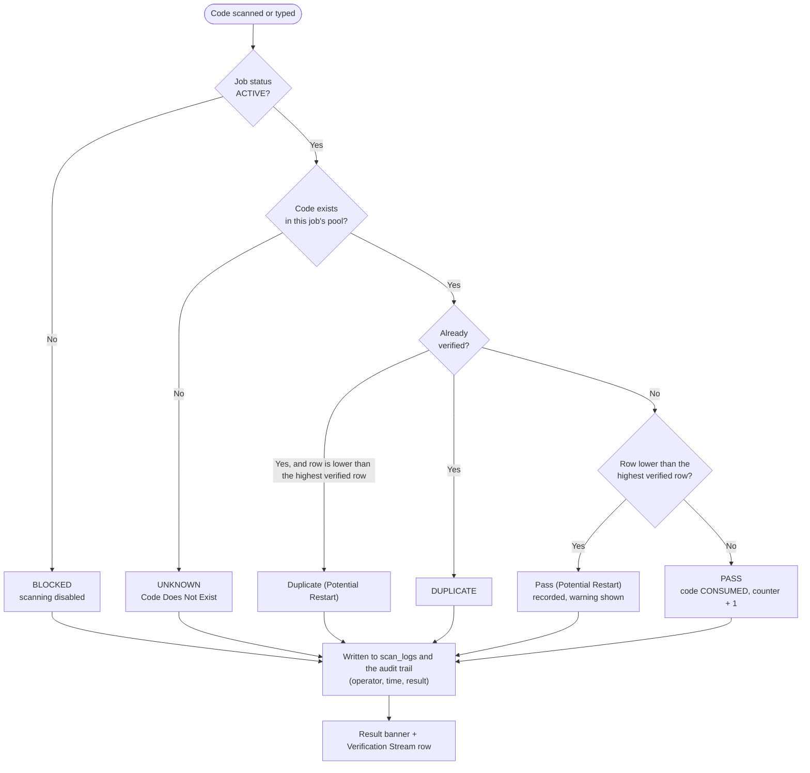
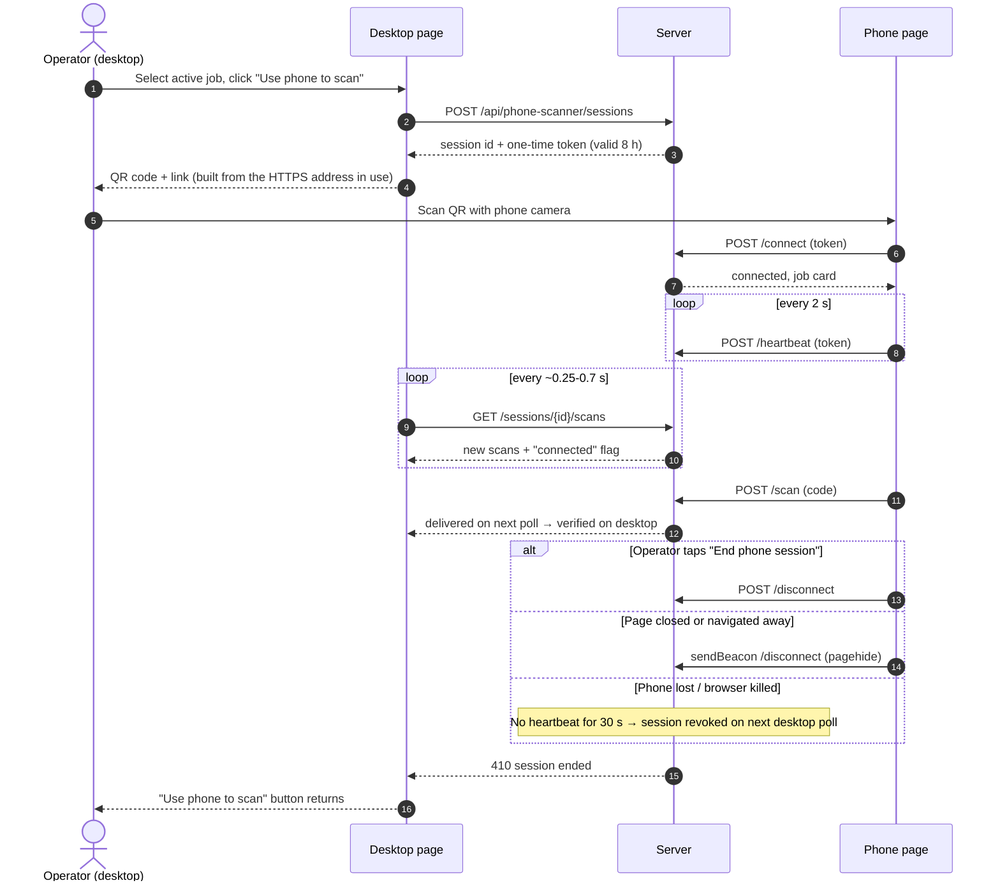
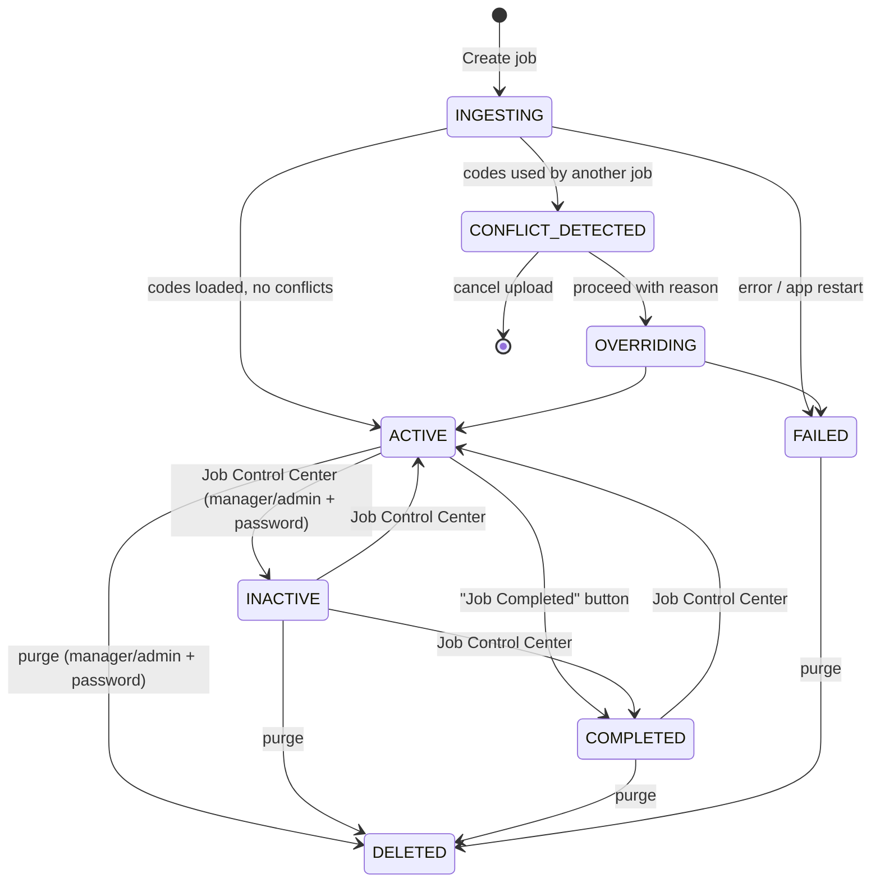
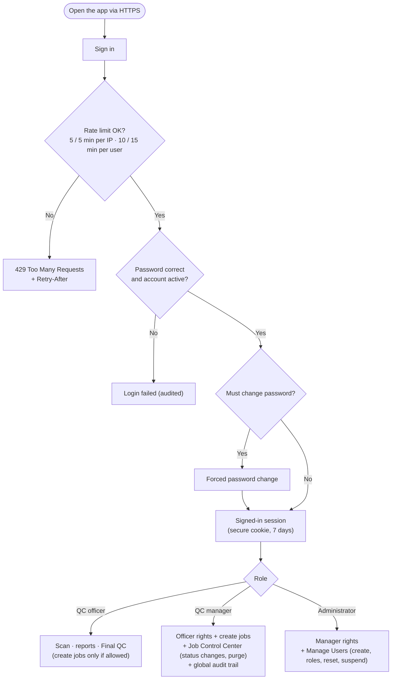
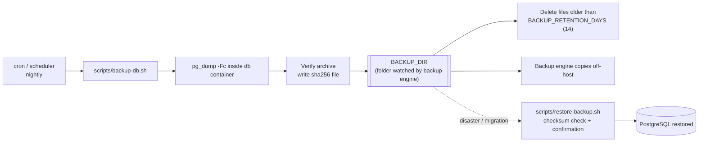

# Label Verifier – System Process Flows

The diagrams below use [Mermaid](https://mermaid.js.org/). They render automatically on GitHub and in VS Code (Markdown Preview Mermaid Support extension). Pre-rendered PDF: [Label-Verifier-Process-Flow.pdf](./Label-Verifier-Process-Flow.pdf).

## 1. System architecture

## 2. End-to-end production workflow

## 3. Job creation and code ingestion

## 4. Scan verification logic (per code)

## 5. Phone scanner pairing and session lifecycle

## 6. Job status life cycle

## 7. User access and security flow

## 8. Backup and restore flow

