# Label Verifier – User Manual

**CCL Middle East – Pakistan · Variable Data Verification System**

Pre-rendered PDF: [Label-Verifier-User-Manual.pdf](./Label-Verifier-User-Manual.pdf). Process diagrams: [process-flow.md](./process-flow.md).

> The screenshots were taken from a demo system with sample data (job cards, codes and users are fictitious).

---

## 1. What the system does

Label Verifier checks that every variable-data code (QR code or serial number) printed on a label or carton belongs to the correct production job, and that no code is used twice.

1. A job's code list (CSV/TXT) is uploaded to create a **Job Card**.
2. Operators **scan each printed code**. The system answers PASS, Duplicate or Unknown within a moment.
3. A **Final QC** step checks sampled packed items and prints a certificate.
4. Everything is recorded in reports and an audit trail.

### Roles

| Role | Can do |
|---|---|
| **QC officer** | Sign in, search a job, scan/verify codes, use the phone scanner, view the QC Report and Lifecycle Audit, use Final QC. Can create jobs only if an admin ticked *Allow creating new job cards* for them. |
| **QC manager** | Everything an officer can, plus create jobs, **Job Control Center** (change status, purge a job) and the global **Audit Trail**. |
| **Administrator** | Everything a manager can, plus **Manage Users** (create users, change roles, reset passwords, suspend accounts). |

---

## 2. Signing in

Open the address given by your IT team (for example `https://192.168.1.50`) in Chrome, Edge or Safari. Enter your **username** and **password** and click **Sign In**.

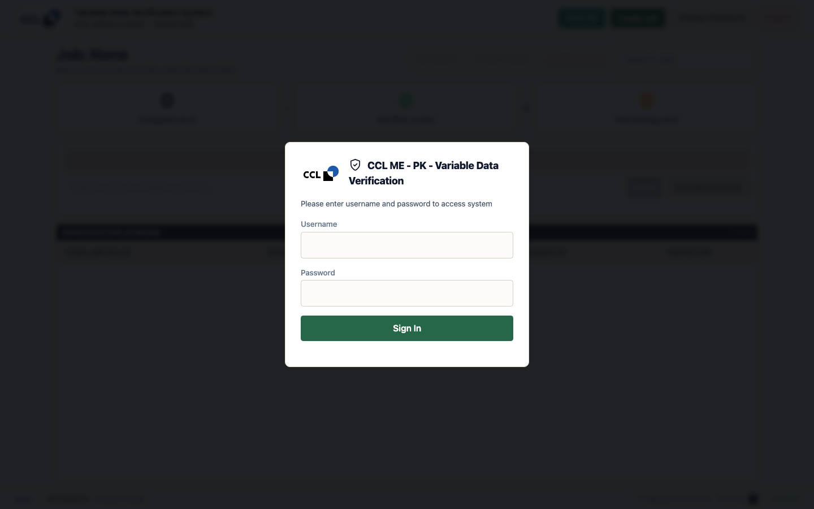

- After several failed attempts the system temporarily blocks further tries (wait a few minutes).
- Passwords must be at least 8 characters.

### First login: set a new password

If your password was set or reset by an administrator you must choose a new one before using the system.

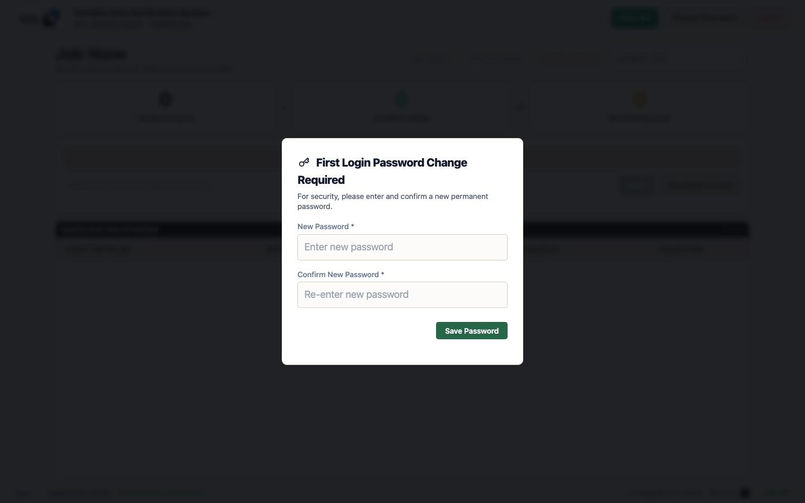

Enter the new password twice and click **Save Password**. You can change it again any time with **Change Password** in the top bar.

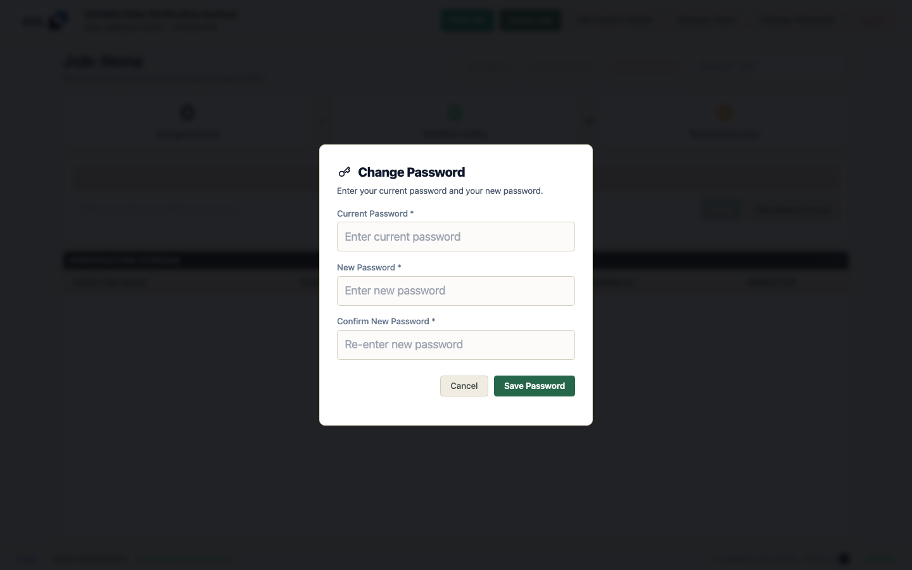

---

## 3. The main screen

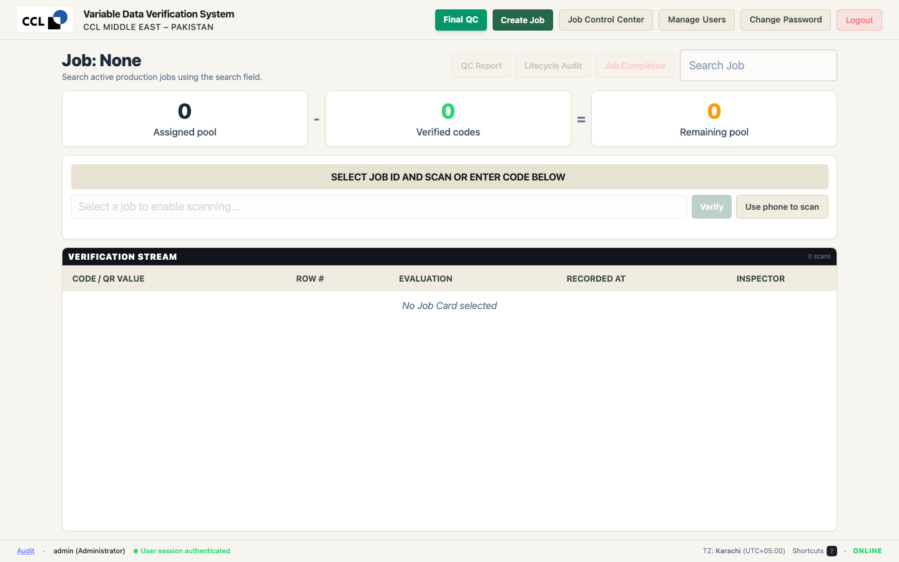

| Area | Purpose |
|---|---|
| **Top bar** | **Final QC**, **Create Job**, **Job Control Center**, **Manage Users** (shown according to your role), **Change Password**, **Logout**. |
| **Job header** | Shows the selected Job Card. Buttons: **QC Report**, **Lifecycle Audit**, **Job Completed**, and the **Search Job** box. |
| **Counters** | **Assigned pool** (codes in the job) − **Verified codes** = **Remaining pool**. |
| **Scan box** | Where you scan or type a code, plus **Verify** and **Use phone to scan**. |
| **Verification Stream** | Live list of every scan with row number, result, time and inspector. |
| **Footer** | Audit link, who is signed in, time zone, keyboard shortcuts, online status. |

### Keyboard shortcuts

Press **F1** or **?** to see them.

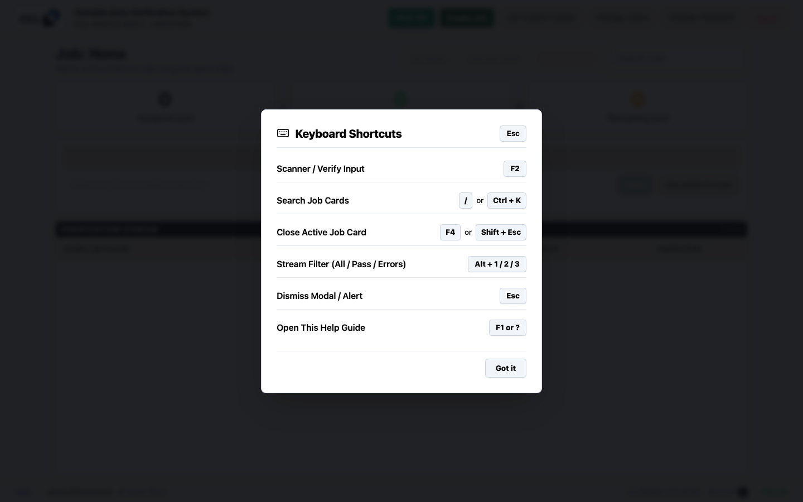

### Time zone

Click the **TZ:** label in the footer to choose the time zone used on screens, reports and certificates.

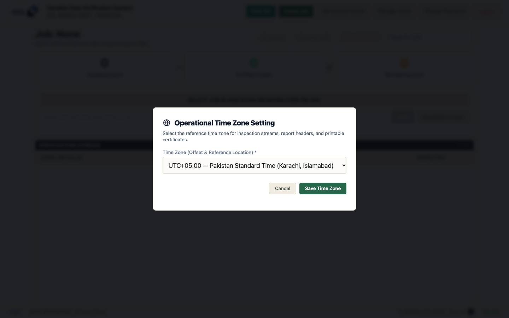

---

## 4. Creating a job *(managers, admins, or officers with upload permission)*

1. Click **Create Job**.
2. Enter the **Job Card #** (required) and an optional description.
3. Choose the **Batch Data File** (CSV or TXT; up to about 4 million codes).
4. Click **Create Job**.

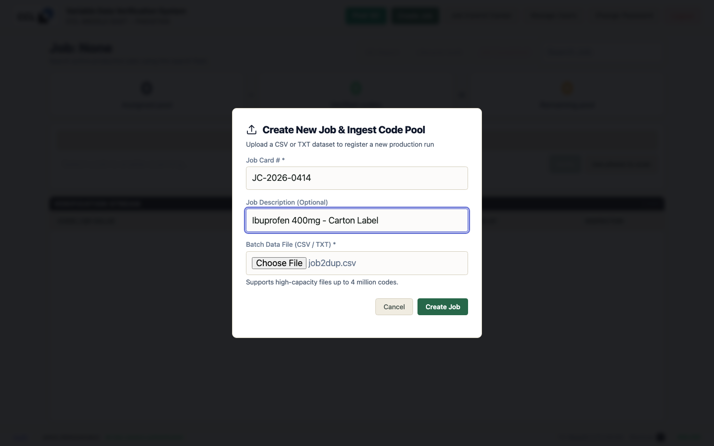

### If the file contains repeated codes

The system **refuses** to create a job whose file has the same code more than once. It lists the repeated codes and the CSV rows where they appear. Click **Download Duplicate Report**, fix the source file and upload it again.

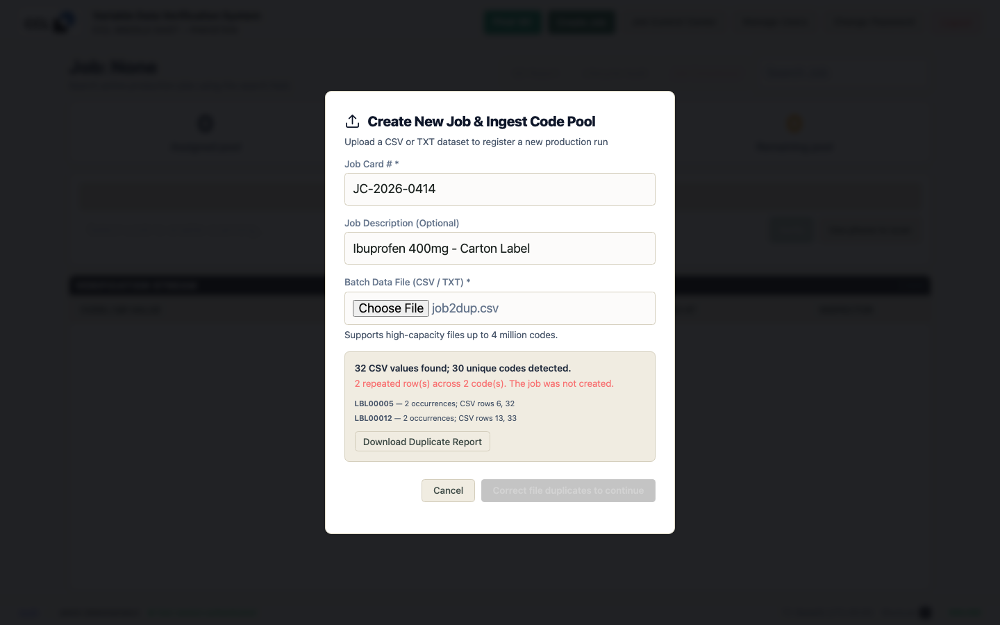

### Successful creation

Large files are loaded in the background. When finished you see a confirmation and the job becomes **ACTIVE**.

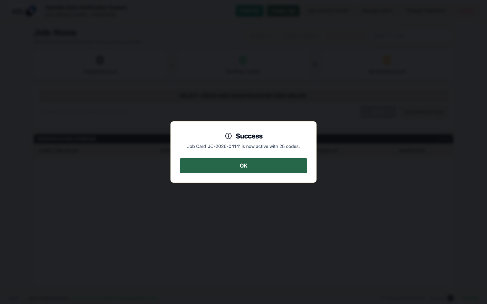

### If codes already exist in another job

The job stops in **conflict** status and a conflict report is shown. The uploader can either **cancel** the upload or **proceed with a written reason** (optionally skipping the conflicting codes). The reason is stored in the audit trail.

---

## 5. Verifying codes (daily operation)

1. Click **Search Job** (or press **/**) and choose your Job Card. Only active jobs can be scanned.
2. Click in the scan box (or press **F2**).
3. Scan the label with the keyboard-wedge barcode scanner, or type the code and press **Enter**.
4. Read the result banner and the Verification Stream.

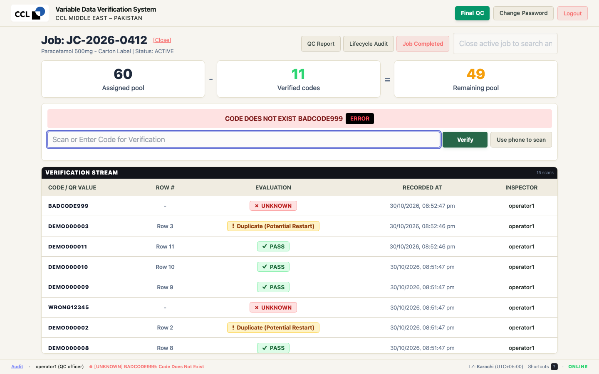

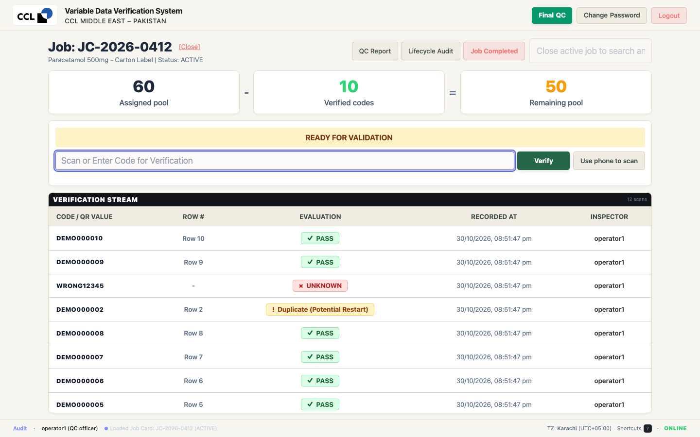

### Results

| Result | Colour | Meaning | What to do |
|---|---|---|---|
| **PASS** | Green | Code belongs to this job and had not been used. | Continue. |
| **Pass (Potential Restart)** | Amber | Valid, but its row is lower than the highest row already verified (printing may have restarted or run out of order). | Check the sequence of the printed labels. |
| **DUPLICATE / Duplicate (Potential Restart)** | Amber | This code was already verified earlier. | Remove or investigate the duplicate label. |
| **UNKNOWN** | Red | Code does not exist in this job (wrong job, misprint, or unreadable). | Re-scan, check you selected the right Job Card, escalate if it repeats. |
| **BLOCKED** | – | The job is not active (inactive or completed). | Ask a manager to reactivate the job. |

Use **Alt + 1/2/3** to filter the stream by All / Pass / Errors. Click **[Close]** next to the job name (or press **F4**) to select a different job.

### Finishing a job

When all codes are verified or the run is over, click **Job Completed**. The job stops accepting scans (a manager can reactivate it).

---

## 6. Phone scanner

Use a phone camera instead of a USB scanner.

**Requirements:** the phone is on the company Wi-Fi, and the system is opened with its **HTTPS address** (not `localhost`). Your IT team installs the company certificate on phones once.

1. On the desktop select an active job and click **Use phone to scan**.
2. Scan the **QR code** with the phone's camera (or open the link shown).

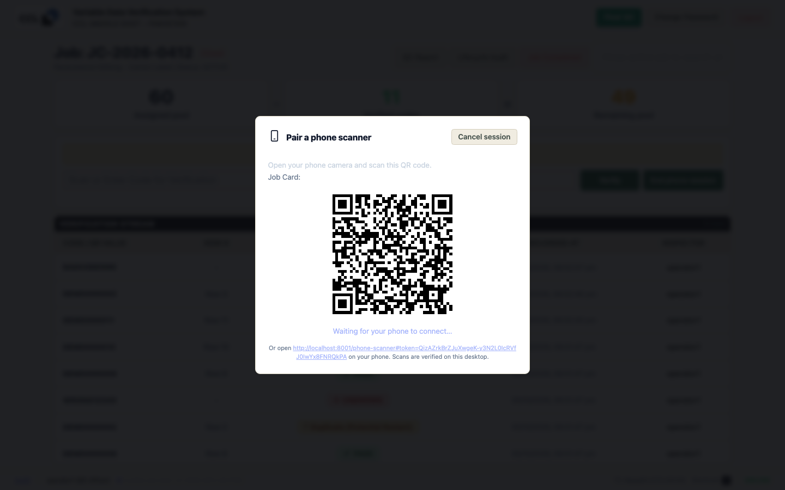

3. The phone page connects to the job and starts the camera. Choose **Barcode / QR** or **Printed text (OCR)**. Use the **1x / 2x / 3x** buttons or slider to zoom.

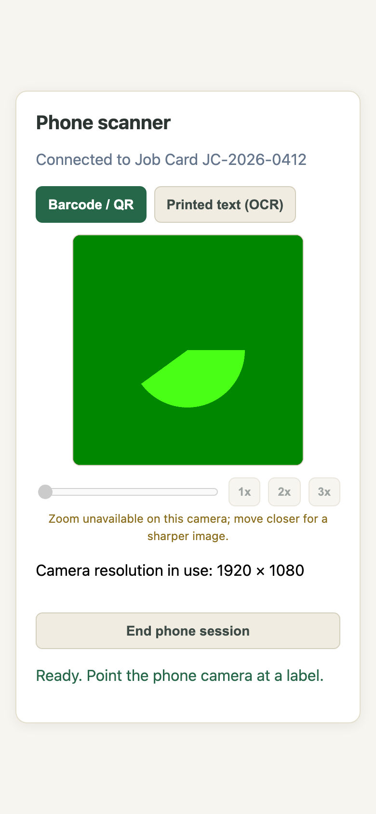
*(In this demo the phone shows a test pattern instead of a real camera.)*

4. Point the camera at a code. It is sent to the desktop and verified; results appear in the Verification Stream. The pairing window closes by itself.

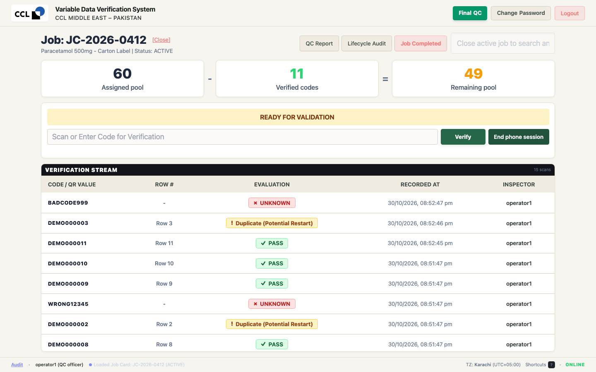

5. To stop, tap **End phone session** on the phone, or **End phone session** on the desktop. **The session also ends automatically when the phone page is closed, the browser is closed, or the phone leaves the page for more than about 30 seconds.** Scan the new QR code to start again.

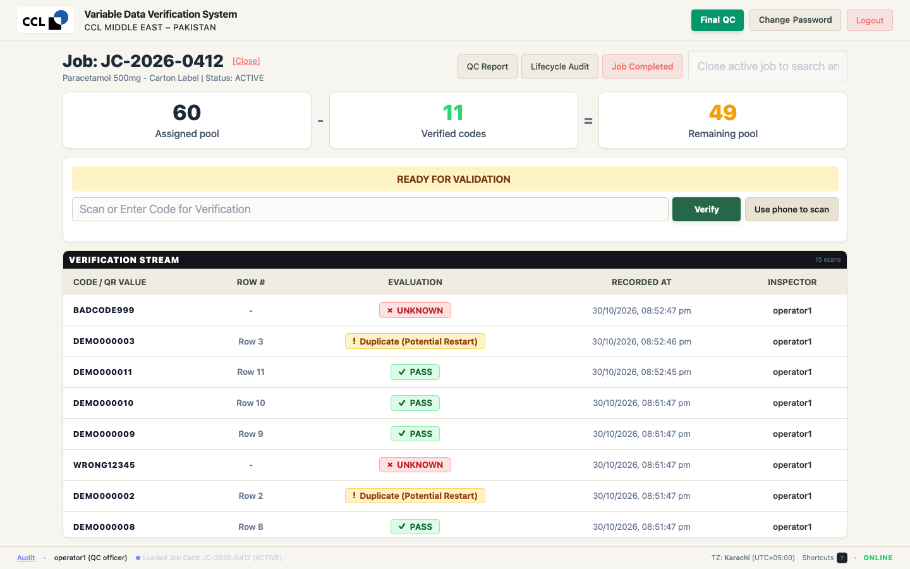

---

## 7. Reports

### QC Report

Click **QC Report** on the job header: every scan with time, inspector, code, row number and result. Use **Print Report** or **Download CSV**.

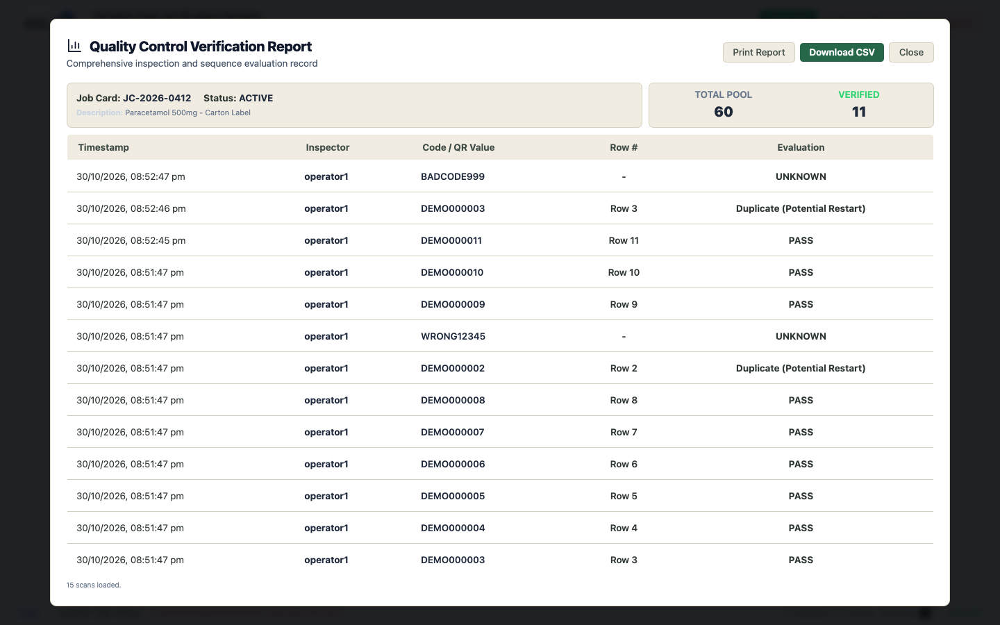

### Lifecycle Audit

Click **Lifecycle Audit** for the history of the job itself (created, activated, completed, purged) with the user and reason.

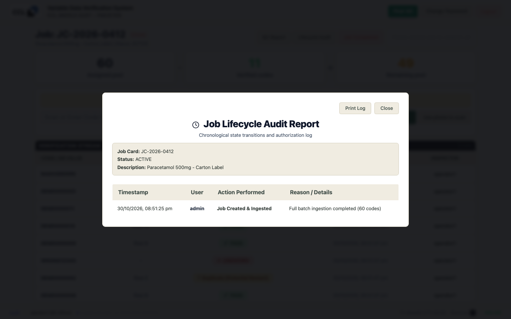

---

## 8. Final QC Terminal

Used after printing, to check sampled items at packing.

1. Click **Final QC**.
2. Enter or scan the **Job Card number** and press **Enter**.
3. Scan or type the code from the packed item and click **Verify**. Each successful check is added to the list.
4. Click **Print Certificate** (available after the first successful check).

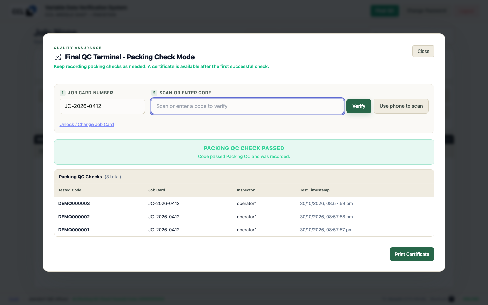

Use **Unlock / Change Job Card** to switch to another job. The phone scanner can also be used here.

---

## 9. Job Control Center *(managers and admins)*

Click **Job Control Center** to see all jobs with date, status, progress, conflicts and Final QC counts.

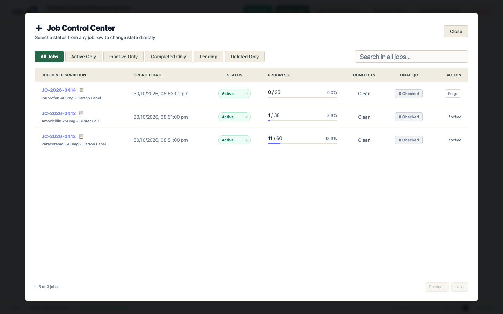

- Filter by **All / Active / Inactive / Completed / Pending / Deleted**, or search.
- Change a job's status from its status drop-down (you confirm with your password).
- Click a Job ID to open it on the main screen.
- **Purge** permanently removes a job that has no verified codes (requires your password and is recorded in the audit trail). Jobs with scans are locked.

## 10. Audit Trail *(managers and admins)*

Click **Audit** in the footer. Every login, scan, job change, Final QC check and user-management action is recorded and cannot be edited. Filter by category, search, **Download CSV** or **Print Report**.

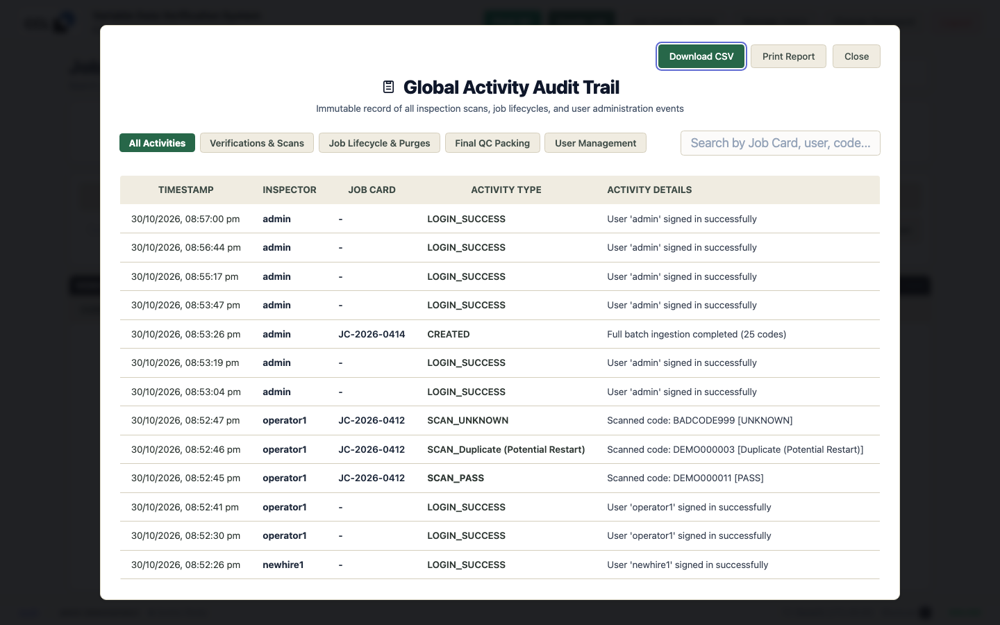

---

## 11. Managing users *(administrators)*

Click **Manage Users**.

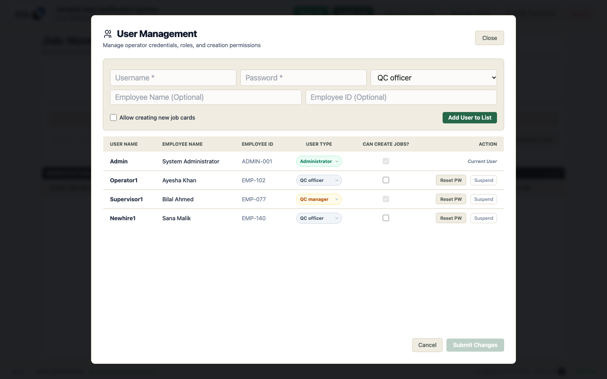

| Task | How |
|---|---|
| Add a user | Enter username, temporary password, role and optional employee name/ID; tick *Allow creating new job cards* if needed; click **Add User to List**. |
| Change role or upload right | Use the role drop-down and the checkbox in the user's row. |
| Reset a password | **Reset PW** – the user must choose a new password at next login. |
| Suspend / re-enable | **Suspend** blocks sign-in without deleting history. |
| Save | Click **Submit Changes** – nothing is applied until you do. |

---

## 12. Troubleshooting

| Problem | Fix |
|---|---|
| "Too many attempts" at login | Wait a few minutes, then try again. |
| Cannot scan: *Job is COMPLETED/INACTIVE* | Ask a manager to set the job to Active. |
| Everything shows UNKNOWN | Wrong Job Card selected, or the printed code does not match the uploaded file. |
| Phone says link expired/ended | Start a new phone session from the desktop (links end when the session ends and after 8 hours). |
| Phone cannot open the page | Same Wi-Fi? Using the HTTPS address, not `localhost`? Company certificate installed? |
| Camera does not start | Allow camera access in the browser. The page must be HTTPS. |
| "The server is busy. Please try again in a moment." | Many users at once; wait a few seconds and retry. |
| Forgot password | Ask an administrator to **Reset PW**. |

---

## 13. For IT: running and maintaining the system

The application runs as Docker containers (`app`, `db`, `proxy`) on an Ubuntu server. See the project [README](../README.md) for installation.

| Task | Command (run in the project folder) |
|---|---|
| Start / update | `docker compose up --build -d` |
| Status | `docker compose ps` |
| Logs | `docker compose logs -f app` |
| Health check | `curl -k https://<server>/healthz` |
| Backup now | `bash scripts/backup-db.sh` |
| Restore | `bash scripts/restore-backup.sh <file>` |

Important settings are in the `.env` file: `SITE_ADDRESS` (the server's IP or DNS name used by browsers and phones), `POSTGRES_PASSWORD`, `SESSION_SECRET`, `BACKUP_DIR` (folder watched by the backup engine) and `BACKUP_RETENTION_DAYS`.
